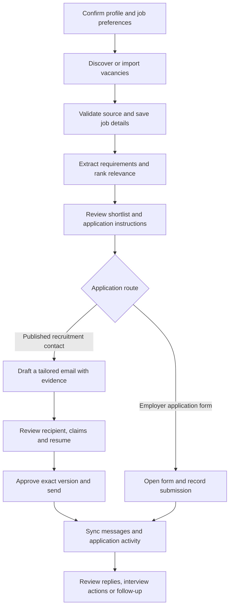

# Folio review and improvement plan

Reviewed on 15 October 2026. Scope: review and planning only; no application code changed.

Folio already has the core parts of a personal job assistant. The next release should make synchronization trustworthy and job/email decisions more accurate before expanding automatic discovery. Keep the existing Next.js application, SQLite database, and worker for local use. A rewrite is not needed to address these gaps.

## Current capabilities

| Area | Implemented today | Main limitation |
| --- | --- | --- |
| Candidate profile | PDF/DOCX/TXT extraction, optional AI extraction, confirmed skills and experience | Experience is mostly free text; no structured seniority, work authorization, or evidence records |
| Finding jobs | Saved company boards on Ashby, Greenhouse, and Lever; CSV and manual entry; scheduled checks | This checks known companies, rather than discovering companies across the web; other sites require manual entry |
| Reading jobs | Full saved description, requirement excerpts, keyword score, optional AI analysis | No persistent structured requirements; mandatory and optional skills are not separated in the local score |
| Writing emails | Local generation, AI generation, writing instructions, shorter/natural rewrites, supporting quotes | Quote presence does not establish that a claim is supported; limited email purposes and one company-level contact |
| Sending | Gmail drafts, attachment handling, explicit version approval, duplicate and allowance checks | Ambiguous outcomes cannot be reconciled; changes or sends made in Gmail are not imported |
| Tracking | Known-thread reply checks, manual application status, one reviewed follow-up | Reply detection has correctness and coverage gaps; no reply reading or classification workflow |
| Operation | Local worker, activity records, connection settings | Failed tasks lack retry scheduling; synchronization progress and freshness are incomplete |

The existing distinctions between an email being sent, an ATS form being submitted, and an application outcome are valuable. Preserve them.

## Verified findings, in priority order

“Reproduced” below means an isolated temporary SQLite database and mocked provider responses. It does not mean a live Gmail account was tested.

### 1. An outgoing draft can be mistaken for an incoming reply — high priority, reproduced

In [gmail.ts](src/lib/gmail.ts#L379), `syncReplies()` excludes `SENT` messages but not `DRAFT` messages or the connected user's own sender address. A newer draft in the original thread sets `replyStatus` to `reply`. Preparing a threaded follow-up can therefore cause the original to look answered and block that follow-up when sending rechecks replies.

Fix: classify direction before classifying content. Exclude drafts and outgoing messages; normalize sender addresses and explicitly known aliases. Keep an inbound message record with its Gmail ID and classification. Fetch the original application's exact thread before sending a follow-up instead of relying on a general batch.

Acceptance: an original email plus an unsent follow-up draft still has no inbound reply; a real recruiter reply blocks the follow-up; the same message is processed once.

### 2. Older applications can stop receiving reply checks — high priority, reproduced

[gmail.ts](src/lib/gmail.ts#L382) checks `drafts.slice(0, 100)`. Records are returned newest first by [db.ts](src/lib/db.ts#L39). With 101 sent records, two runs checked the same newest 100 and omitted the oldest. Original emails and follow-ups can also cause repeated requests for the same thread. A single thread returning 404 aborted the run before another valid thread was checked.

Fix: initially deduplicate thread IDs, persist a rotating cursor or last-check timestamp, and isolate per-thread failures. Treat missing threads, authentication failures, transient errors, and rate limits differently. Add Gmail incremental synchronization in the next increment.

Acceptance: every one of 250 tracked threads is eventually checked; one missing thread does not prevent valid threads from updating; expired credentials are surfaced without recording a successful reply check.

### 3. Uncertain sends and direct Gmail actions have no reconciliation — high priority, code review

[gmail.ts](src/lib/gmail.ts#L358) moves any failed send result to `uncertain`. That is a sensible duplicate-send precaution, but [service.ts](src/lib/service.ts#L78) then prevents edits and there is no recovery action. Uncertain messages also continue counting toward the sending allowance. A message sent directly from Gmail leaves the app's draft state stale.

Fix: persist a send-attempt record and stable RFC Message-ID before contacting Gmail. Add “Check Gmail status” that searches Sent, fetches candidate messages, and verifies their identity before linking them. Reconcile remote sends, deletions, and draft changes; show content conflicts for review. Record the remote draft ID promptly when saving succeeds, including when the subsequent read fails.

A missing search result is not proof that a send failed. Keep ambiguous cases blocked and expose the evidence; never add a blind retry button. A Message-ID is a correlation aid, not an exactly-once delivery guarantee.

Acceptance: a timeout after Gmail accepted a send becomes `sent` after verified reconciliation, without a second send; an unproven outcome stays uncertain; sending the same draft in Gmail updates the app.

### 4. A malformed feed can incorrectly close jobs — high priority, reproduced

[jobs.ts](src/lib/jobs.ts#L116) converts a Greenhouse ID with `String(j.id)` before validation. A missing ID becomes the truthy string `"undefined"`, passes the later completeness check, and allows the scan to close an existing listing as absent. Lever has the same conversion pattern.

Fix: validate provider responses with explicit schemas before normalization, including IDs, titles, links, item uniqueness, and pagination completeness. Persist a scan result separately from job changes. Only close absent jobs after a fully validated scan of that exact source and board. Preserve records on schema or pagination failures.

Acceptance: a malformed item, duplicate ID, or interrupted page leaves existing jobs open and records a failed scan; a valid complete scan closes genuinely removed jobs.

### 5. Keyword coverage can look like full qualification — medium priority, reproduced

[matching.ts](src/lib/matching.ts#L17) removes seniority words when comparing preferred titles. Required years and work eligibility do not affect its numerical score. A confirmed profile targeting a junior backend role with Node.js/PostgreSQL and no stated years scored 100 for a senior role requiring eight years and US work authorization. Generic unknowns were present, but the score was still shown as strong.

Fix: separate skill overlap from eligibility and seniority. Extract each requirement with a supporting job quote. Represent checks as supported, not evidenced, contradicted, or unknown. A missing profile fact is unknown, not a rejection. Show unresolved mandatory requirements prominently and label keyword results “skill overlap” instead of overall “% fit.”

Acceptance: the example above highlights unresolved experience and authorization instead of implying complete qualification; country-restricted remote work is distinguished from worldwide remote work; optional skills have lower weight than requirements.

### 6. Valid quotations can accompany invented email claims — medium priority, reproduced

[ai.ts](src/lib/ai.ts#L187) verifies that a source quote occurs in the profile. It does not verify that the quote supports its associated claim or that all body claims have evidence. A mocked response inventing 15 years of experience and leadership of 40 engineers passed with a real quote about building a Node.js API. The README already acknowledges this limitation.

Fix: give confirmed candidate facts stable IDs and make email generation cite those IDs per factual claim. Check years, numerical achievements, names, qualifications, and attachment claims against those facts. Show each supported claim beside its source and flag unlinked claims. A second model may assist review, but cannot establish factual truth by itself.

Acceptance: invented years or team sizes cannot receive a “supported” result; a quotation contradicting the claim is flagged; manual edits invalidate affected evidence; all sends retain explicit review.

## The intended daily workflow

The overview should answer three questions immediately: which jobs deserve attention, which applications need an action, and whether the data is current.

## Product improvements

### Find and read jobs properly

- Add saved searches for role, seniority, country, city, work arrangement, employment type, salary preference, and posting age. Let the user save searches independently of their company list.
- Add a connector interface so each source owns URL recognition, response validation, pagination, normalization, and freshness. Extend sources incrementally after the three existing connectors are reliable.
- Add “Import a job URL” with preview and source attribution. Supported public pages can use structured job data; fall back to pasted text when extraction is unavailable. Validate remote destinations and redirects before adding arbitrary page fetching.
- Store source, board, provider job ID, canonical URL, first seen, last seen, last successful check, content hash, and source text. Deduplicate within a source and flag likely duplicates across sources for review.
- Preserve structured provider fields instead of discarding them. Ashby already exposes work arrangement, employment type, and additional locations; [its official API documentation](https://developers.ashbyhq.com/docs/public-job-posting-api) supports using these fields.
- Extract responsibilities, mandatory/preferred skills, seniority, required experience, eligible countries, sponsorship statements, compensation, application method, and any special email instructions. Store the source excerpt for each extracted requirement; missing facts stay unknown.
- Make the job detail view show a short summary, the original description, evidence of fit, unresolved requirements, freshness, and the next action. Keep salary and location filters separate from skill ranking.

### Write professional, accurate emails

- Offer explicit purposes: application, speculative inquiry, referral request, follow-up, and reply to a recruiter. Use the correct context and wording for each purpose.
- Keep the existing short, plain-English style. Build each application from the exact role/company, one or two relevant confirmed examples, the selected résumé, an optional useful portfolio link, and one polite closing request.
- Parse employer instructions before composing: required subject, job/reference ID, requested documents, and whether email applications are accepted. Surface missing documents instead of implying they are attached.
- Add contacts per job as well as per company, with name, role/purpose, address, source URL, and confirmation date. Use a named greeting only when that name is confirmed. Do not infer deliverability from a checkbox or generate guessed addresses.
- Add résumé versions with an explicit preview and selection for each application. Preserve the selected attachment when the profile changes; ask for review when its supporting facts change.
- Provide focused actions such as “Fix grammar,” “Shorten,” and “Emphasize this project.” Show changes before replacement and preserve the previous version locally.
- Store structured claim/evidence links instead of presentation strings. Include a review checklist for recipient, subject instructions, factual claims, attachment, and signature.

A useful composition pattern is: exact role and company → relevant work example → connection to one stated responsibility → attached résumé/portfolio if present → polite request → signature. Do not add years, outcomes, or achievements unless they are confirmed facts.

### Synchronize Gmail and track the application

- Start with the reply fixes above, then persist a Gmail `historyId` and process all pages of changes. Commit the cursor only after the changes have been durably handled. Rebuild the relevant baseline if the cursor expires; Google's [synchronization guide](https://developers.google.com/workspace/gmail/api/guides/sync) documents this recovery requirement.
- Use polling for the local installation. Consider push notifications only when there is an appropriate hosted worker and notification setup. Keep an explicit “Sync now” action with last success, pending work, errors, and retry time.
- Link messages using known Gmail IDs and thread IDs first. Use reference headers and corroborating application details for new-thread replies. Require review when matching is ambiguous, especially when several jobs share a recruiter.
- Provide a focused application inbox. Retrieve the relevant message content when needed; distinguish human reply, acknowledgement, out-of-office message, interview request, rejection, and delivery failure. Keep uncertain classification visible and reversible.
- Suggest application-status changes from messages and let the user confirm them. Store status history and its supporting message rather than overwriting the status without context.
- Recheck the specific application's latest incoming messages before offering or sending a follow-up. Recognized acknowledgements and out-of-office replies need explicit handling; do not equate every automated message with a recruiter response.
- Preserve thread ID, reply references, and subject compatibility for follow-ups. These are documented requirements in Google's [thread guide](https://developers.google.com/workspace/gmail/api/guides/threads).

### Make background work understandable and reliable

- Add task attempts, next retry time, error category, lease owner/expiry, and per-task progress. Retry safe reads with bounded backoff; distinguish terminal errors from temporary outages.
- Keep the worker heartbeat independent of a long scan. Currently the UI considers a heartbeat older than 90 seconds offline while one task can involve many sequential external calls.
- Separate vacancy-check and mail-sync scheduling so a long company queue does not indefinitely delay reply tracking. Give follow-up preflight checks their own targeted operation.
- Paginate jobs and activity instead of loading and rescoring the workspace every seven seconds. [service.ts](src/lib/service.ts#L43) currently truncates jobs at 2,000 without pagination, which can hide older applications' job context.
- Show “last successful sync,” “checking,” “retrying,” and “needs reconnect” separately. A queued task or a refreshed browser screen should not be presented as successful external synchronization.
- Add a documented backup/restore check for the database, encrypted files, and matching encryption key. Keep SQLite for the local single-owner workflow; choose hosted persistence and a durable worker separately if cloud deployment becomes a requirement.

## Suggested data changes

Use versioned SQLite migrations; adding a server database is not required for these features. The current JSON records can remain while new queryable entities are introduced incrementally.

| Entity | Purpose and key fields |
| --- | --- |
| Candidate fact | ID, type, confirmed value, résumé/source quote, confirmation and version |
| Job requirement | Job/version, kind, required/preferred, value, source quote, confidence |
| Job source record / scan | Provider, board, external ID, canonical URL, content hash, scan completeness and timestamps |
| Recruitment contact | Company/job scope, name, purpose, email, source, confirmation |
| Application | Job, chosen résumé, formal status, next action, status history |
| Email / message | Application, purpose, direction, Gmail/message/thread IDs, classification and evidence |
| Draft version / send attempt | Exact content and attachment reference, approval, correlation ID, attempt outcome |
| Sync state / task | Account cursor, last success, lease, retry schedule, progress and error |

## Delivery order and completion criteria

| Increment | Work | Complete when |
| --- | --- | --- |
| 1 — Correctness | Draft/reply distinction, fair thread coverage, per-thread failure handling, targeted follow-up check, feed validation | Regression cases for the reproduced reply/feed defects pass; existing approval and duplicate-send tests still pass |
| 2 — Trustworthy synchronization | Durable send attempts, uncertain-send recovery, Gmail-originated changes, incremental sync, visible task progress | External sends and timeouts reconcile without duplicates; missed pages and expired history cursors recover; status reflects actual sync success |
| 3 — Better decisions and writing | Structured profile facts and job requirements, eligibility review, claim checks, contact/résumé selection | Seniority/eligibility examples show correct uncertainty; unsupported numerical claims are flagged; résumé and contact are explicit per application |
| 4 — Discovery and daily workflow | Saved searches, additional supported sources, URL import, application inbox, next-action dashboard, pagination | A user can discover, evaluate, prepare, send or submit, and track an application with clear provenance and current status |

Do not make automatic email sending part of these increments. Preserve the existing explicit approval and send interaction. Discovery, synchronization, matching, and reminders can run automatically.

## Verification performed and remaining checks

- `npm test`: **32 passed, 0 failed**.
- `npm run typecheck`: **passed**.
- Six isolated reproductions confirmed the specific scenarios described above: own draft mistaken for reply, older-thread starvation, one-error batch abort, misleading perfect keyword score, malformed feed acceptance, and unsupported AI claim acceptance.
- Temporary reproduction script: `/tmp/folio-review-V7JPzy/reproduce.mts`. It mocks external requests and removes its temporary database after execution; the script path is session-local evidence, not a permanent test suite.
- No application code was changed. No employer messages were sent, and no live Gmail or paid AI calls were made for this review.
- Browser interaction and production build were not rerun for this review. The existing `VERIFICATION.md` records earlier build results and deferred signed-in browser verification; those are separate from the checks above.

During implementation, add regression tests for each fixed defect, connector fixtures for all three providers, message-classification cases, uncertain-send recovery, and task restart/cursor recovery. Then verify the signed-in browser workflow with an isolated workspace. Live Gmail lifecycle checks should use a test mailbox and an explicitly authorized test recipient.
